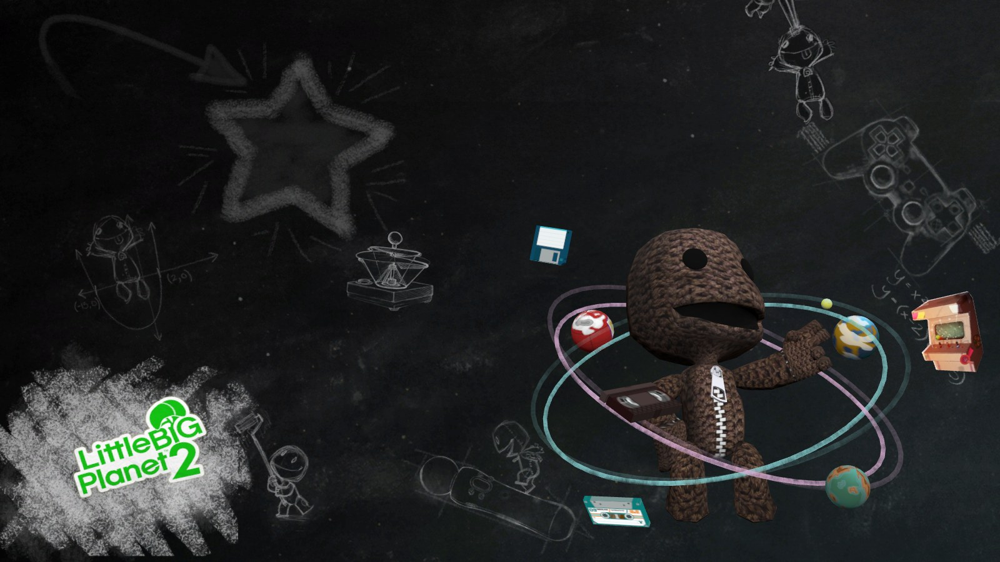

# dynamicthemer

Tools for PS3 dynamic themes. Point it at a theme `.pkg` (with its `.rap`) or a `.p3t` and it decrypts it,
pulls out the icons and backgrounds, and turns the 3D background into a glTF file you can open in the
included browser viewer or in Blender.



The viewer plays the scene with its animations and runs the theme's own script, so logo sequences, face
swaps and other scripted bits behave like they do on the console. There's also a panel for jumping between
the states the script cycles through.

## Setup

Python 3.10+:

```bash
pip install -r requirements.txt
```

## Build a theme

```bash
python tools/build_theme.py "Some Game (USA) (Dynamic Theme).zip" --name some_game
```

The input can be:

- a `.zip` holding the theme `.pkg` and its `.rap`
- a `.pkg` plus `--rap license.rap`
- a plain `.p3t`

Output lands in `themes/<name>/`:

| Path | Contents |
|---|---|
| `theme.p3t` | the decrypted theme |
| `p3t_out/` | icons, pointers and previews as PNG, plus `tree.xml` |
| `p3t_out/*_raf/` | the dynamic background: textures as PNG, meshes, skeletons, animations, script, `tree.xml` |
| `scene.glb` | the full 3D scene with skins, animations and the embedded script |

`themes/index.json` is updated so the viewer lists the theme.

## View it

Serve the repo folder and open the viewer:

```bash
python -m http.server 8000
```

Then go to `http://localhost:8000/viewer/`.

- Pick a theme from the dropdown, or use **Choose File** to open any `scene.glb`.
- **States** lists each state machine in the theme's script. Pick a state to jump to it; it stays held until
  you untick **hold**.
- **Theme camera** returns to the theme's original viewpoint, **Frame** (or `F`) zooms to the visible objects.
- Add `?noscript` to the URL to see the scene without its script.

`scene.glb` also opens in Blender or any glTF viewer (without the script).

## Tools

| Tool | Does |
|---|---|
| `tools/build_theme.py` | the whole pipeline in one command |
| `tools/ps3_pkg_extract.py` | decrypt and extract a retail PKG |
| `tools/ps3_edat_decrypt.py` | decrypt an EDAT with its RAP |
| `tools/p3t_unpack.py` | unpack P3T / RAF containers, convert GIM and GTF images to PNG |
| `tools/raf_to_gltf.py` | convert a RAF scene to glTF |
| `tools/es01.py` | skeleton and inverse-bind reader |
| `tools/ea03.py` | animation decoder |
| `tools/vsmx.py` | script disassembler |
| `viewer/vsmx_vm.js` | script interpreter used by the viewer |

Each tool also runs on its own; see the usage line at the top of each file.

## Formats

[docs/formats.md](docs/formats.md) documents every layer: PKG, EDAT, the P3T/RAF resource tree, the scene tree,
Edge geometry (including index compression and skinning), skeletons, Edge animation
([docs/ea03-format.md](docs/ea03-format.md)), and the VSMX script bytecode with its host API and the state-machine
library themes use.

## Note

Use themes you own. This repo contains no theme content, no `.rap` licenses and no Sony software; you supply
the theme and its license.
